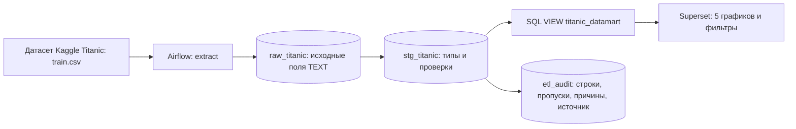
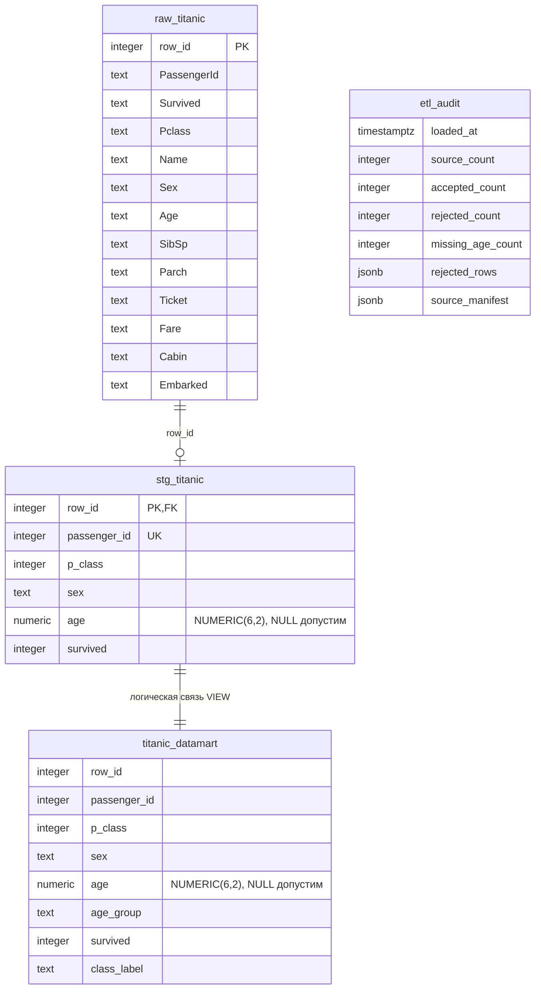
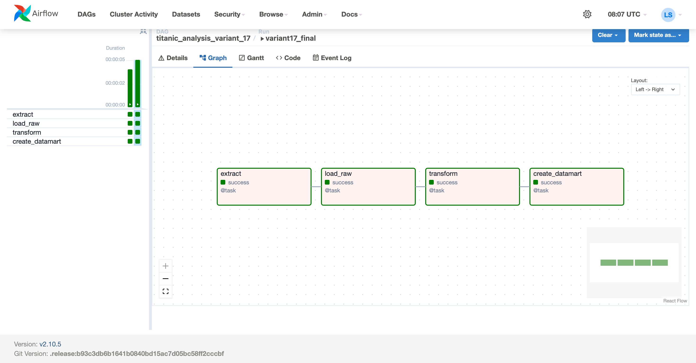
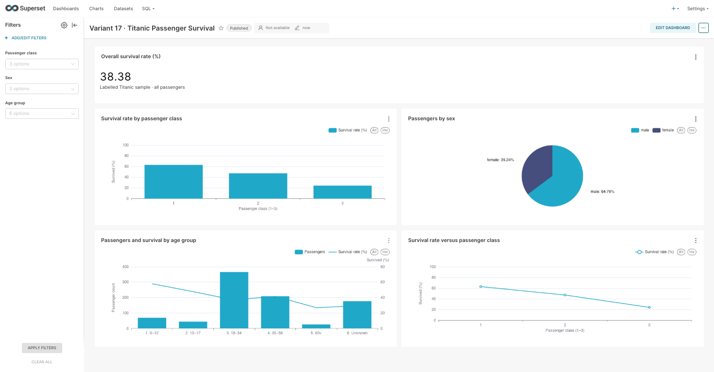
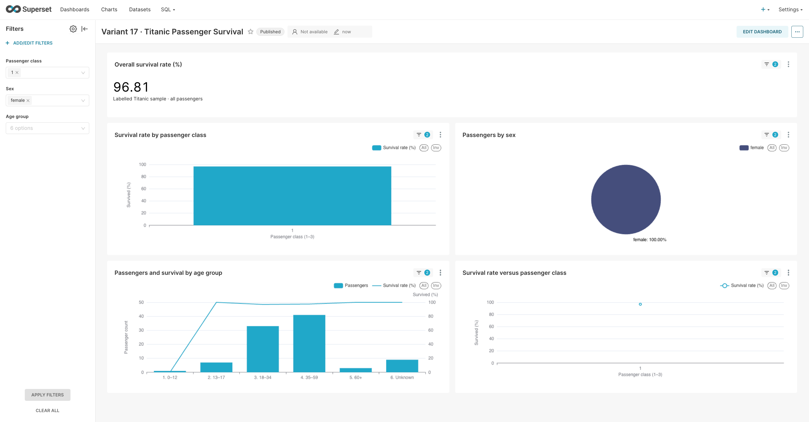
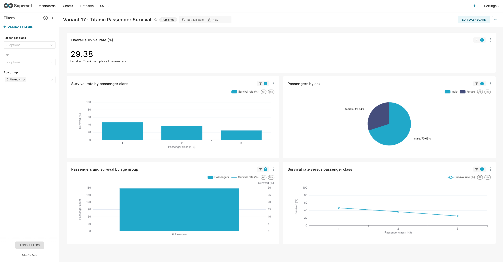

# Лабораторная работа 3 — вариант 17
## Анализ пассажиров «Титаника»

Среда выполнения: Ubuntu 20.04.4 LTS ARM64 в VirtualBox на Mac с Apple M4. Конвейер: получение исходного CSV → Apache Airflow → PostgreSQL RAW → STG → SQL VIEW → Apache Superset.

## Цель работы
Выявить различия доли выживших между классами обслуживания и возрастными группами, описать состав пассажиров по полу и показать влияние неполноты данных на анализ. Результат — интерактивный дашборд для исследования исторической выборки и проверки гипотез. Данные не позволяют устанавливать причинный эффект класса или возраста на выживание.

## Источник и единица наблюдения
В работе используется обучающая выборка датасета [Titanic — Machine Learning from Disaster на Kaggle](https://www.kaggle.com/competitions/titanic/data): 891 пассажир и 12 исходных полей. Файл `train.csv` содержит фактический признак выживания `Survived`, который используется для расчёта метрик.

В RAW сохраняются все исходные поля. Число строк, URL загрузки и SHA-256 записываются в `source_manifest.json` и `etl_audit.source_manifest`.

SHA-256 проверенного CSV: `4a437fde05fe5264e1701a7387ac6fb75393772ba38bb2c9c566405af5af4bd7`.

Единица наблюдения — один пассажир в обучающей выборке, идентификатор `PassengerId`. Набор из 891 строки не является полным списком всех людей на борту.

## Исследуемые метрики
| Метрика | Исходные поля и формула | Аналитический вопрос |
|---|---|---|
| Общий процент выживших | 100 × SUM(Survived) / COUNT(*), эквивалентно 100 × AVG(survived) | Какая доля пассажиров выборки выжила? |
| Процент выживших по классу | Та же формула GROUP BY Pclass | Как различаются наблюдаемые результаты для классов 1–3? |
| Доли по полу | COUNT(*) по Sex / общее COUNT(*) | Каков состав анализируемой выборки? |
| Число пассажиров и выживание по возрасту | COUNT(*) и 100 × AVG(survived) по группе Age | Как соотносятся размер возрастной группы и доля выживших? |
| Выживание в зависимости от класса | 100 × AVG(survived), X = p_class | Как выглядит различие классов на линейном графике? |

Проценты считаются по пассажирам текущей отфильтрованной выборки, а не как среднее процентов разных групп. `Survived = 1` означает выжил, `0` — не выжил. `class_label` — текстовая копия `p_class` для дискретной оси графиков с подписями 1, 2, 3 без промежуточных значений. Все требуемые поля присутствуют либо явно выводятся из исходных; метрики не заменялись.

## Правила преобразования и качество данных
- `Pclass` → `p_class`, допустимые значения 1, 2, 3; `Sex` → `sex`, нормализация пробелов и регистра; `Survived` → `survived`, строго 0 или 1.
- `PassengerId` приводится к положительному уникальному INTEGER.
- `Age` хранится как NUMERIC(6,2), чтобы сохранить дробный возраст младенцев. Пустой возраст становится NULL, без замены нулём или средним.
- Возрастные интервалы: `[0,13)` → «0–12»; `[13,18)` → «13–17»; `[18,35)` → «18–34»; `[35,60)` → «35–59»; `[60,120]` → «60+»; NULL → «Unknown / Неизвестен».
- Названия групп используют нижнюю и верхнюю целую границу как подпись; математические интервалы выше задают точное правило для дробного возраста.
- 177 записей с неизвестным возрастом сохраняются, участвуют в общей метрике, круговой диаграмме и сравнении классов, а на возрастном графике выделены в отдельную группу.
- Пропуски Cabin и Embarked не приводят к удалению пассажира: эти поля не нужны для показателей варианта. Неиспользуемые поля остаются в RAW.
- Ошибки типов, недопустимые категории, повторный идентификатор и некорректный непустой возраст приводят к отклонению с номером строки, идентификатором и причиной в `etl_audit.rejected_rows`.

Контрольный баланс: **891 RAW = 891 STG = 891 VIEW**, отклонено 0. Неизвестный возраст — характеристика качества данных, а не потеря строки.

## Архитектура решения


STG строится SELECT-запросом из RAW в PostgreSQL. CSV повторно для трансформации не читается. Витрина создаётся отдельным SQL-файлом, Dataset Superset подключён к VIEW `public.titanic_datamart`.

| Сервис | Роль |
|---|---|
| environment-init | Создание постоянных случайных ключей и прав рабочего тома |
| postgres | Отдельные базы метаданных Airflow и Superset |
| analytics_postgres | RAW, STG, VIEW, журнал ETL |
| airflow-init | Миграции, учётная запись администратора и Connection |
| webserver | Интерфейс Airflow |
| scheduler | Планирование и выполнение задач через LocalExecutor |
| redis | Кэш Superset |
| superset-init | Миграции и роли Superset |
| superset | Визуализации и интерактивный дашборд |
| pgadmin | Администрирование PostgreSQL |

Контейнеры инициализации после успеха завершаются с кодом 0; постоянные сервисы остаются запущенными.

## Технологический стек
- VirtualBox 7.2.12; Ubuntu 20.04.4 LTS ARM64; Docker Engine 26.1.3; Compose v2.27.1.
- Apache Airflow 2.10.5, Python 3.11, apache-airflow-providers-postgres 6.0.0, psycopg2-binary 2.9.10.
- PostgreSQL 12.22; Apache Superset 4.1.2; Redis 7.4.2; pgAdmin 9.1.
- Стандартные библиотеки Python: CSV, HTTPS, ZIP, Decimal, SHA-256, JSON.

## ER-диаграмма

RAW содержит все 12 исходных полей TEXT и технический ключ `row_id`. VIEW не хранит отдельную копию данных. `etl_audit` — журнал запусков, не таблица пассажиров.

## Исходный код и экспорт
- [DAG](dags/titanic_dag.py).
- [SQL-витрина](dags/datamart_variant_17.sql).
- [Docker Compose](docker-compose.yml).
- [Создание дашборда](superset/bootstrap_dashboard.py).
- [Экспорт Superset ZIP](superset/dashboard_export.zip).
- [JSON с экспортированными настройками](superset/dashboard_export.json).

Технический способ получения CSV: использована [публичная копия обучающей выборки Data Science Dojo](https://github.com/datasciencedojo/datasets/blob/master/titanic.csv). Адрес загрузки и контрольная сумма сохранены в [манифесте](verification/source_manifest.json).

В Superset 4.1.2 штатный формат переноса — ZIP/YAML. JSON содержит те же девять объектов экспорта; восстановление импортируемого ZIP:
```bash
python3 superset/json_to_zip.py superset/dashboard_export.json /tmp/titanic_dashboard.zip
```
Затем Dashboards → Import. При запросе пароля аналитической базы используется учебный пароль `analytics`.

## Запуск и подключение
На Ubuntu с установленными Docker Engine и Compose v2, из папки проекта:
```bash
sudo docker compose up -d
sudo docker compose ps
```
Первый запуск не требует ручного создания `.env` и настройки прав. Ключи создаются автоматически и сохраняются в томе `lab_keys`; данные конвейера — в `pipeline_data`. Имя проекта фиксировано: `titanic_variant17`.

Адреса:
- Airflow: http://127.0.0.1:8082 — `admin` / `admin`.
- Superset: http://127.0.0.1:8090 — `admin` / `admin`.
- pgAdmin: http://127.0.0.1:5052 — `admin@admin.com` / `admin`.

На Mac используются правила NAT VirtualBox: 8082→8082, 8090→8090, 5052→5052, адрес хоста 127.0.0.1. В браузере самой Ubuntu доступны эти же порты.

Connection `analytics_postgres` автоматически создаётся в метаданных Airflow: тип Postgres; host `analytics_postgres`; port `5432`; schema/database `analytics`; login/password `analytics`. DAG получает соединение через `PostgresHook`; задача загрузки RAW выполняет `test_connection()`, результат записывается в лог. Кнопка Test в интерфейсе включена.

В Airflow включите `titanic_analysis_variant_17` и запустите DAG. После успеха четырёх задач:
```bash
sudo docker compose exec -T superset python /app/lab/bootstrap_dashboard.py
```
Дашборд: http://127.0.0.1:8090/superset/dashboard/titanic-analysis-17/ . Повторный запуск скрипта обновляет графики по именам.

## Описание работы и результаты
Независимый расчёт исходного CSV: 891 пассажир, выжили 342, не выжили 549. Общая доля выживших — **38,38%**.

| Класс | Пассажиры | Выжившие | Доля выживших |
|---|---:|---:|---:|
| 1 | 216 | 136 | 62,96% |
| 2 | 184 | 87 | 47,28% |
| 3 | 491 | 119 | 24,24% |
| Всего | 891 | 342 | 38,38% |

| Возрастная группа | Пассажиры | Выжившие | Доля выживших |
|---|---:|---:|---:|
| 0–12 | 69 | 40 | 57,97% |
| 13–17 | 44 | 21 | 47,73% |
| 18–34 | 366 | 135 | 36,89% |
| 35–59 | 209 | 87 | 41,63% |
| 60+ | 26 | 7 | 26,92% |
| Неизвестен | 177 | 52 | 29,38% |
| Всего | 891 | 342 | 38,38% |

Состав по полу: male — 577, female — 314, сумма 891. Все разрезы сходятся с итогом. Общий процент вычисляется из числа выживших и общего числа пассажиров, не как невзвешенное среднее строк таблицы.

Пять обязательных типов визуализаций:
1. Индикатор общего процента выживших.
2. Столбчатая диаграмма процента выживших по `p_class`.
3. Круговая диаграмма состава по `sex`.
4. Комбинированная диаграмма: количество пассажиров столбцами, процент выживших линией по `age_group`, отдельные оси с единицами.
5. Линейная диаграмма процента выживших по классу.

Фильтры «Passenger class», «Sex» и «Age group» применяются ко всем пяти графикам.







## Проверка выполнения и воспроизводимости

Успешный запуск Airflow: `variant17_final` от 04.11.2026, 22:15:33 UTC (05.11.2026, 01:15:33 МСК). Все четыре задачи завершены со статусом `success`. Проект проверен при первом запуске с отдельными пустыми томами.

Преобразование дополнительно выполнено при временно недоступном CSV: задача прочитала RAW и получила 891 строку STG. После проверки CSV восстановлен. RAW — 891, STG — 891, отклонённых строк — 0, пропусков возраста — 177; SQL-витрина содержит 342 выживших и общий процент 38,383838%. Проверка подключения к аналитической базе завершилась успешно.

Проверка фильтров в интерфейсе 05.11.2026:

| Выбор | Проверенный процент | Область действия |
|---|---:|---|
| Класс 1 | 62,96% | Все пять графиков |
| Класс 1 и female | 96,81% (91 из 94) | Все пять графиков |
| Возраст 6. Unknown | 29,38% (52 из 177) | Все пять графиков |
| После сброса | 38,38% | Вся выборка |



Сервисы Airflow, Superset и pgAdmin вернули HTTP 200: [проверка доступности](verification/health.txt). Дополнительные материалы: [независимый расчёт CSV](verification/source_stats.json), [фактический источник и контрольная сумма](verification/source_manifest.json), [состояние контейнеров](verification/containers.txt).

## SQL создания витрины
```sql
CREATE OR REPLACE VIEW titanic_datamart AS
SELECT row_id, passenger_id, p_class, sex, age,
 CASE WHEN age IS NULL THEN '6. Unknown'
      WHEN age < 13 THEN '1. 0–12'
      WHEN age < 18 THEN '2. 13–17'
      WHEN age < 35 THEN '3. 18–34'
      WHEN age < 60 THEN '4. 35–59'
      ELSE '5. 60+' END AS age_group,
 survived, p_class::TEXT AS class_label
FROM stg_titanic;
```

## Выводы
1. **Наблюдение:** в выборке доля выживших в первом классе — 62,96%, в третьем — 24,24%. **Объяснение:** классы могли различаться по расположению помещений, составу пассажиров и условиям эвакуации; эти факторы здесь не контролируются. **Действие:** исследовать разрезы по полу и возрасту, не трактуя разницу как доказанный причинный эффект стоимости билета или класса.
2. **Наблюдение:** 177 из 891 пассажира (19,87%) не имеют указанного возраста. **Объяснение:** возрастные сведения неполны; исключение таких строк изменило бы состав выборки. **Действие:** сохранять отдельную группу неизвестного возраста и явно учитывать её при сопоставлении результатов.
3. **Наблюдение:** группа 60+ содержит только 26 пассажиров; её доля выживших — 26,92%. **Объяснение:** небольшой размер группы повышает чувствительность процента к отдельным наблюдениям. **Действие:** показывать численность рядом с процентом и не переносить результат на широкую популяцию.
4. **Наблюдение:** мужчин в выборке 577, женщин 314. **Объяснение:** простое число выживших без знаменателя зависит от состава выборки. **Действие:** при сравнении сегментов использовать процент внутри сегмента и проверять численность после применения фильтров.

## Ограничения
Используется историческая обучающая выборка, а не полный пассажирский список; выводы относятся к этим 891 записи. Возраст частично отсутствует; пол и возраст связаны с другими характеристиками. Границы возрастных интервалов выбраны аналитиком и влияют на агрегаты. Линейный график соединяет категории класса для выполнения задания и не означает непрерывную шкалу или интерполяцию между классами. Причинные выводы и индивидуальные прогнозы по этим диаграммам не делаются.

## Остановка и повторный запуск
```bash
sudo docker compose down
sudo docker compose up -d
```
Тома сохраняются. Повторный DAG пересоздаёт RAW, STG и VIEW, сохраняя историю качества в `etl_audit`. При изменениях Dockerfile или requirements: `sudo docker compose up -d --build`.
